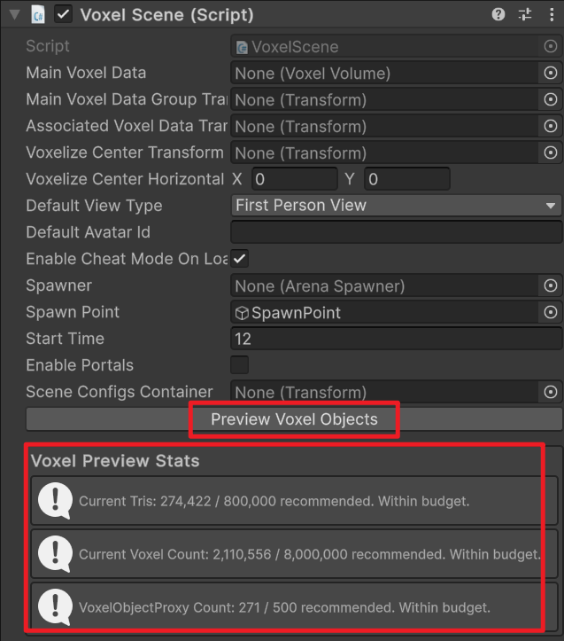

# Tutorial: Track

This tutorial demonstrates how to create a custom **Track** or scene mod. This approach is suitable for race tracks, parkour maps, or any custom environment for players to explore.

**Path in Mod Toolkit**: `Assets/Samples/com.cydream.trackscene`

[Track Mod on mod.io](https://mod.io/g/voxel-playground/m/track#description)

## Step 1: Modeling in MagicaVoxel

First, create your scene in MagicaVoxel. Since a track is a complex environment, you should use the **World Editor** in MagicaVoxel to organize your scene into multiple objects.

### Naming Conventions

To ensure the game recognizes the different parts of your track correctly (e.g., what is the floor vs. what are obstacles), you **must** follow the specific naming conventions for scene objects.

Refer to the [Scene Naming Guide](./tools-voxel-authoring-magica-voxel.md#naming-for-scene) for the complete list of prefixes.

*   **`A_` (Static Environment)**: Use this prefix for the main track geometry, floors, and walls. These objects are indestructible and static.
    *   *Example*: `A_Road`, `A_Wall`, `A_StartLine`
*   **`B_` (Dynamic Prop)**: Use this for obstacles or objects that can be moved or destroyed.
    *   *Example*: `B_Crate`, `B_Barrier`

### Material IDs

Ensure you use the correct colors in the palette to define material properties (like hardness or slippery surfaces). See [Material ID Mapping](./tools-voxel-authoring-magica-voxel.md#material-id-mapping).

## Step 2: Import into Editor

Once your `.vox` file is ready:

1.  Open the **Asset Processor** in the Mod Toolkit.
2.  Drag and drop your `.vox` file into the processor.
3.  **Crucial Step**: In the import settings for this file, select **Type** as **Scene**.
4.  Click **Convert** to generate the scene prefab.

For more details on the import process, see [MagicaVoxel Import](./tools-voxel-authoring-magica-voxel.md#import-into-editor).

## Step 3: Configure Mod Manifest

After generating the prefab, you need to register it in your `ModManifest`.

1.  Locate your `ModManifest` asset.
2.  Add your new Track Prefab to the **Export Prefabs** list (or the specific Scene list if available in your version).
3.  Ensure the mod type is set correctly if applicable.

See [Configure Mod Manifest](./quick-start-create-mod.md#step-4-configure-the-manifest) for general instructions.

## Step 4: Validate Scene Budget

Before testing or publishing the scene, select the `Voxel Scene` component and click **Preview Voxel Objects**. The preview displays three budget metrics:

*   **Current Tris**: The generated triangle count compared with the recommended budget.
*   **Current Voxel Count**: The total voxel count compared with the recommended budget.
*   **VoxelObjectProxy Count**: The number of voxel object proxies compared with the recommended budget.

For the Track sample, the preview reports `274,422 / 800,000` tris, `2,110,556 / 8,000,000` voxels, and `271 / 500` voxel object proxies, all within budget.

If any value is over budget, simplify the voxel model, split or merge objects where appropriate, and preview again before exporting.

## Step 5: Test and Publish

Now you can build and test your track in the game.

*   [Testing your Mod](./quick-start-test-mod.md)
*   [Publishing your Mod](./quick-start-publish-mod.md)
